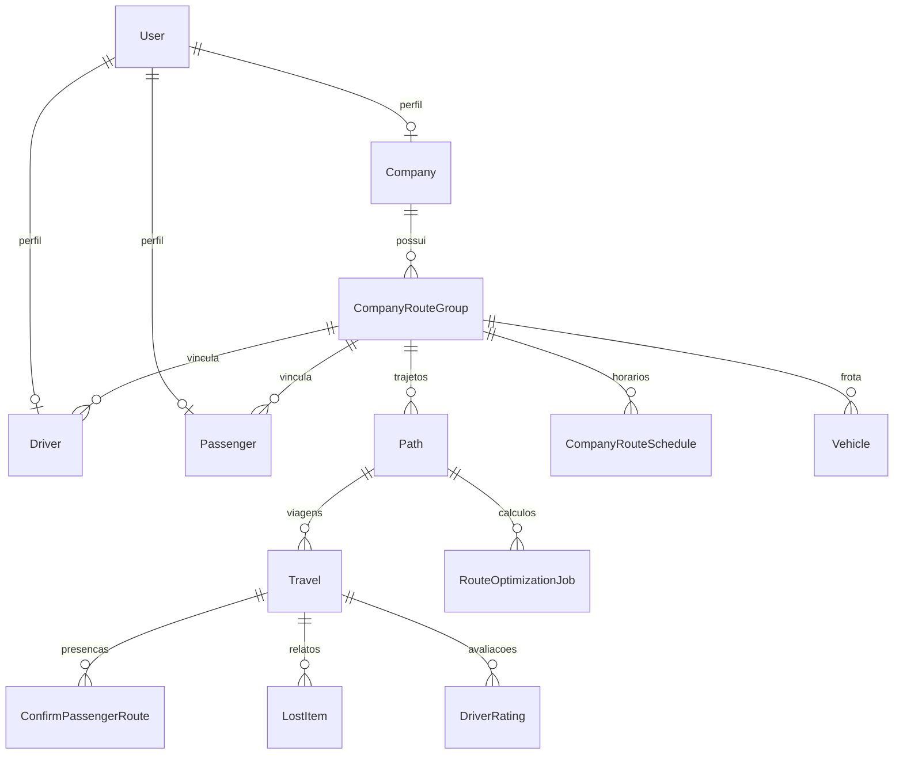

# Arquitetura

## Dependências e dados
`modules/accounts/models/user.py::User` é identidade; `modules/organizations/models/company_route_group.py::CompanyRouteGroup` reúne empresa, motorista e aluno; `modules/transport/models/travel.py::Travel` usa trajeto, veículo e motorista; `modules/uploads/models/document.py::Document` guarda anexos. Relações:

Fontes: `modules/organizations/models/company.py::Company`, `modules/organizations/models/driver.py::Driver`, `modules/organizations/models/passenger.py::Passenger`, `modules/transport/models/path.py::Path`, `modules/transport/models/route_optimization_job.py::RouteOptimizationJob`, `modules/transport/models/driver_rating.py::DriverRating`.

## Camadas e canais
- URLs agregadas em `app/api.py::router`; viewsets filtram querysets por usuário + ação; serializers validam domínio e podem gravar transacionalmente (`modules/transport/api/views/travel.py::TravelViewSet`, `modules/transport/api/serializers/travel.py::TravelCreateSerializer`). `modules/transport/services.py::save_travel_location` centraliza validação REST/WS; `modules/transport/optimization.py::process_optimization` centraliza cálculo HTTP/worker.
- Signals carregados em `modules/transport/apps.py::TransportConfig.ready`: `modules/transport/signals.py::passenger_changed` e `modules/transport/signals.py::passenger_address_changed` marcam trajeto desatualizado; `QuerySet.update()` não dispara signal. `shared/address.py::GeocodableAddressMixin.save` invalida coordenadas ao mudar endereço.
- REST: JWT Bearer ou cookie HttpOnly + CSRF em mutações; sessão ativa obrigatória em `modules/accounts/authenticate.py::CustomAuthentication`; defaults IsAuthenticated em `app/settings/base.py::REST_FRAMEWORK`. Objeto e queryset **também** precisam proteger cada action; matriz em [DOMINIO](DOMINIO.md). Admin: staff em `app/admin.py` e revisão em `modules/organizations/admin.py::CompanyAdmin`.
- WS: `app/asgi.py::application` valida Origin; `modules/accounts/ws_auth.py::JWTAuthMiddleware` autentica cookie ou Bearer (não URL); `modules/transport/routing.py::websocket_urlpatterns` usa `/ws/travels/<travel_id>/location/`. `modules/transport/consumers.py::TravelLocationConsumer.connect` aceita só viagem ativa e participante aprovado, envia posição atual se houver; `receive` revalida sessão/acesso, somente motorista transmite; `location_update` revalida receptor; `travel_closed` encerra após finish. `modules/transport/services.py::save_travel_location` publica `location_update` no grupo `travel_<id>` após commit; `modules/transport/api/views/travel.py::TravelViewSet._change_status` publica `travel_closed` ao finalizar. Redis necessário para mais de um processo (`app/settings/base.py::CHANNEL_LAYERS`).

## Integrações
- OSRM em `modules/transport/osrm.py::optimize_coordinates`: `OSRM_URL`, `/trip/v1/driving/<lon,lat;...>`, timeout `OSRM_TIMEOUT_SECONDS`, tentativas `OSRM_MAX_ATTEMPTS`, limite `OSRM_MAX_STOPS`, distância de snap e cache por hash; erro HTTP 400/422/502/503, sem inventar trajetória. Geocodificação em `shared/geocoding.py::geocode_address`: `GEOCODING_URL`, timeout/tentativas; `strict=True` falha, `False` devolve `(None,None)`. Ambos recebem dados sensíveis: somente serviços autorizados (decisão do dono, infraestrutura a confirmar).
- E-mail de código é síncrono dentro de transação em `modules/accounts/api/views/email_token.py::EmailTokenViewSet.create_token` / `modules/accounts/services.py::send_email_token`; aprovação de perfil usa `transaction.on_commit` + executor de threads, **não Celery** (`modules/organizations/mixins/is_approved.py::dispatch_approval_email_on_commit`); sem SMTP o backend de console pode imprimir códigos em desenvolvimento (`app/settings/dev.py::EMAIL_BACKEND`); prod exige SMTP (`app/settings/prod.py::EMAIL_HOST`).
- Job de rota com `async_mode=True` é persistido no banco; worker `modules/transport/management/commands/process_route_jobs.py::Command.handle` faz polling, retry e claim com lock (`modules/transport/optimization.py::claim_job`). Não execute worker com banco de dados reais nesta tarefa.
- Imagens via backend padrão local ou Cloudinary (`app/settings/base.py::MEDIA_STORAGE_BACKEND`); documentos via armazenamento privado local mesmo com Cloudinary (`modules/uploads/models/document.py::get_document_storage`). Download protegido em `modules/uploads/api/views.py::DocumentUploadViewSet.download`.

## Ambientes e deploy
- `manage.py::main` usa `app.settings.dev` por padrão; `app/asgi.py::application` e `app/wsgi.py::application` usam `app.settings.prod`. Defina `DJANGO_SETTINGS_MODULE` explicitamente para sobrescrever. Não há Celery/Beat; `modules/transport/management/commands/process_route_jobs.py::Command.handle` é o worker real.
- `app/settings/base.py::BASE_DIR` é a raiz; `app/settings/dev.py::DATABASES` usa SQLite se `DATABASE_URL` não existir; `app/settings/dev.py::DATABASES` lê `.env` sem sobrescrever variáveis do processo. `app/settings/prod.py::_required` recusa ambiente incompleto e `app/settings/prod.py::DATABASES` exige PostgreSQL com credenciais. `app/settings/prod.py::REDIS_URL` é obrigatório: cache e channel layer são configurados em `app/settings/base.py::CHANNEL_LAYERS`.
- `prod.py` ativa redirecionamento HTTPS, cookies Secure e HSTS; `app/settings/prod.py::SECURE_PROXY_SSL_HEADER` só é seguro atrás de proxy TLS que **remove cabeçalhos enviados pelo cliente** e define `X-Forwarded-Proto` corretamente. Teste `pdm run check-deploy` com variáveis fictícias inline, não copie credenciais para docs.
- `Dockerfile` usa Daphne e PDM em virtualenv; `compose.yaml` inicia `web`, `worker` de jobs, PostgreSQL e Redis. `web` roda `collectstatic`; volumes `media`, `private_documents` e `postgres_data` persistem. A porta HTTP liga só em `127.0.0.1`: configure proxy TLS e os hosts/origens públicos fora do Compose. `DATABASE_URL` deve usar o host `db` e as mesmas credenciais de `POSTGRES_*` (codifique caracteres especiais na URL). Rode migrations manualmente antes de atender tráfego; não rode `seed_demo_data` em produção (`Procfile`). Build Docker, rede/SMTP e TLS reais não verificados.

## Variáveis (somente nomes; exemplo em `.env.example`)
| Nomes | Papel |
|---|---|
| `DJANGO_SETTINGS_MODULE`, `FRONTEND_URL`, `FRONTEND_ADMIN_URL`, `BACKEND_HOST`, `BACKEND_PORT` | seleção de ambiente, URL/origens locais em `app/settings/dev.py::CORS_ALLOWED_ORIGINS`; prod não usa URLs locais como fallback de CORS. |
| `SECRET_KEY`, `ALLOWED_HOSTS`, `CORS_ALLOWED_ORIGINS`, `DATABASE_URL`, `REDIS_URL`, `PRIVATE_DOCUMENT_ROOT` | obrigatórias em `app/settings/prod.py::_required`; `PRIVATE_DOCUMENT_ROOT` fica fora de `MEDIA_ROOT`. |
| `OSRM_URL`, `GEOCODING_URL`, `EMAIL_HOST`, `EMAIL_HOST_USER`, `EMAIL_HOST_PASSWORD` | obrigatórias em prod; URLs de serviços privados e SMTP, sem backend de console (`app/settings/prod.py::EMAIL_BACKEND`). |
| `POSTGRES_DB`, `POSTGRES_USER`, `POSTGRES_PASSWORD` | somente Compose, provisionam o PostgreSQL (`compose.yaml`). |
| `CLOUDINARY_URL`, `EMAIL_USE_TLS`, `EMAIL_PORT`, `DEFAULT_FROM_EMAIL`, `EMAIL_TIMEOUT`, `EMAIL_TOKEN_EXPIRATION_MINUTES`, `EMAIL_TOKEN_MAX_ATTEMPTS`, `EMAIL_TOKEN_RESEND_SECONDS` | mídia e e-mail (`app/settings/base.py::STORAGES`, `app/settings/base.py::EMAIL_TIMEOUT`). |
| `LOCATION_MAX_AGE_SECONDS`, `LOCATION_MIN_INTERVAL_SECONDS`, `GEOCODING_TIMEOUT_SECONDS`, `GEOCODING_MAX_ATTEMPTS`, `OSRM_TIMEOUT_SECONDS`, `OSRM_MAX_ATTEMPTS`, `OSRM_MAX_STOPS`, `OSRM_MAX_SNAP_DISTANCE_METERS`, `OSRM_CACHE_TIMEOUT_SECONDS` | limites de integração/telemetria (`app/settings/base.py::LOCATION_MAX_AGE_SECONDS`). |

## Armadilhas
- `app/settings/base.py::AUTH_USER_MODEL` é `authenticator.User` (label, não path); prefira `settings.AUTH_USER_MODEL` em novas relações e `get_user_model()` em código genérico.
- `modules/transport/optimization.py::resolve_waypoint` inverte latitude/longitude para OSRM; respostas e modelos usam latitude/longitude nomeados.
- `modules/transport/api/serializers/travel.py::TravelCreateSerializer` declara `company` read-only: DRF ignora entrada do cliente; view infere pelo trajeto. Verifique campos omitidos no serializer antes de aceitar API nova.
- `modules/transport/models/path.py::Path.save` marca `is_outdated`; `modules/transport/signals.py::passenger_changed` também. Não execute chamadas externas dentro de lock longo sem revisar concorrência.
- `modules/transport/signals.py::passenger_address_changed` depende de `post_save`; `QuerySet.update()` não o aciona. Ao alterar endereço em massa, invalide `Path.is_outdated` explicitamente (a necessidade deve ser avaliada por fluxo).
- `modules/transport/api/serializers/confirm_passenger_route.py::ConfirmPassengerRouteCreateSerializer.create` usa `update_or_create` e aceita `confirm=False`; não confunda com a action monotônica `modules/transport/api/views/confirm_passenger_route.py::ConfirmPassengerRouteViewSet.confirm`. Regras e pendência em [DOMINIO](DOMINIO.md) e [PROGRESSO](PROGRESSO.md).
- `modules/transport/api/serializers/driver_rating.py::DriverRatingCreateSerializer.validate` verifica presença fora do lock de `modules/transport/api/serializers/driver_rating.py::DriverRatingCreateSerializer.create`; revalide estado na transação se a presença puder mudar concorrentemente (risco não reproduzido).
- `modules/organizations/mixins/is_approved.py::dispatch_approval_email_on_commit` submete e-mail pós-commit, mas engole falhas do executor; persistência da aprovação não garante entrega. `modules/transport/optimization.py::claim_job` usa `skip_locked`: teste concorrência com PostgreSQL, não SQLite.
- `modules/transport/api/views/travel.py::TravelViewSet._create_passenger_confirmations` acessa `passenger.user` sem `select_related`; medir consultas em grupos grandes antes de otimizar. `modules/organizations/api/serializers/company.py::CompanyListAndRetrieveSerializer.to_representation` remove dados públicos só após serializar campos aninhados; medir consultas e evitar inferir vazamento na resposta.
- Consulte problemas de privacidade e testes em [PROGRESSO](PROGRESSO.md) antes de afirmar isolamento integral.
